

  

  
  
  
  
  

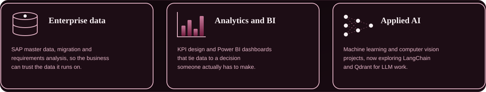

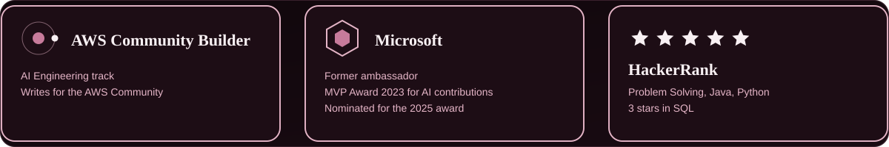

  
  
  
  

<a href="https://github.com/AdityaSrivastavDS/PoseGuard"></a>

<a href="https://github.com/AdityaSrivastavDS/AI-Augmented-Design-Feedback-System"></a>

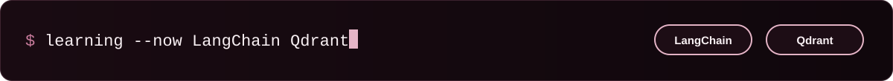


  <a href="https://aditya-srivastav-portfolio.netlify.app/"></a>
  <a href="https://www.linkedin.com/in/adityasrivastav1/"></a>
  <a href="https://community.aws/@adityads"></a>
  <a href="https://leetcode.com/u/Aditya_DSAI/"></a>
  <a href="https://www.geeksforgeeks.org/user/adityathex00q/"></a>
  <a href="https://www.hackerrank.com/profile/aditya_ds"></a>
  <a href="https://twitter.com/Aditya_DSAI"></a>
  

