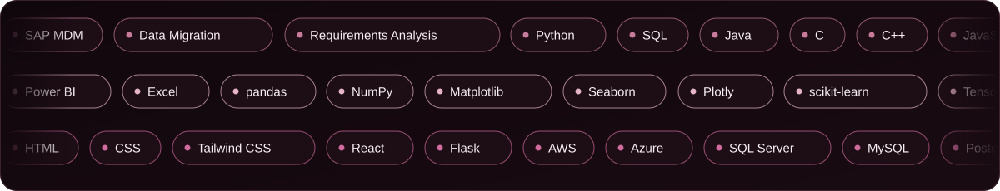

  

  <a href="https://aditya-srivastav-portfolio.netlify.app/"><b>Portfolio</b></a> &nbsp;·&nbsp;
  <a href="https://www.linkedin.com/in/adityasrivastav1/"><b>LinkedIn</b></a> &nbsp;·&nbsp;
  <a href="https://community.aws/@adityads"><b>AWS Community</b></a> &nbsp;·&nbsp;
  <a href="https://leetcode.com/u/Aditya_DSAI/"><b>LeetCode</b></a> &nbsp;·&nbsp;
  <a href="https://www.hackerrank.com/profile/aditya_ds"><b>HackerRank</b></a>

I work where **enterprise data meets decisions**. As a Solutions Consultant at **Prospecta Software**, my days go into SAP master data, enterprise data migration and the unglamorous, high-stakes job of turning a business requirement into a data solution that holds up in production. My background is analytics, so I tend to ask one question before I build anything: *what decision is this number supposed to change?*

I hold a **BCA in Data Science and Artificial Intelligence** from Babu Banarasi Das University, Lucknow, and I have kept my engineering hands warm along the way: computer vision, predictive modelling, dashboards and a lot of competitive programming.

**What I do**

- **Enterprise data management.** SAP master data, enterprise data migration and requirements analysis, so the data a business runs on is something it can trust.
- **Analytics and business intelligence.** KPI design and Power BI dashboards that connect data to the decision someone actually has to make.
- **Applied AI.** Machine learning and computer vision projects, plus ongoing work with LLM tooling.

**Beyond the day job.** I'm an **AWS Community Builder** (AI Engineering), I write for the AWS Community, I'm a former Microsoft ambassador and the founder of **Mahir Insight Institute**. Off the clock I make lifestyle content as *AdityaLives*.

> Data informs decisions. Products evolve through insights. Strategy creates competitive advantage.

| | |
|---|---|
| **AWS Community Builder** | AI Engineering track |
| **Microsoft** | Former ambassador · Microsoft MVP Award 2023 for AI contributions · nominated for the 2025 award |
| **HackerRank** | 5 stars in Problem Solving, Java and Python · 3 stars in SQL |

A migration is rarely a technical problem first. It is a **trust** problem: does the business believe the data on the other side? That shapes how I work.

1. **Start with the requirement, not the table.** I pin down what the business needs the data to do before touching a field.
2. **Surface the mess early.** Profiling finds duplicates, gaps and conflicting definitions while they are still cheap to fix.
3. **Make the mapping explicit.** Every source field has a documented destination and a reason.
4. **Validate with the people who own the data.** Reconciliation counts only when the business signs off.
5. **Leave governance behind.** Clean master data should stay clean, and feed the reporting that depends on it.

  
  
  
  

<b>PoseGuard in more detail</b>

 

PoseGuard is a real-time driver monitoring system. After login, the camera feed starts and a trained CNN watches the driver's posture. When it sees an unwanted pose such as drowsiness or phone use, it plays a warning sound, saves a timestamped screenshot and logs the event. Admins review incidents through a role-based portal and a reports page. The repository's README reports 500+ incidents logged and visualised across test runs.

**Stack:** Python · TensorFlow / Keras · OpenCV · Flask · Tailwind CSS · SQLAlchemy · SQLite · bcrypt

<b>AI-Augmented Design Feedback System in more detail</b>

 

A framework that gives AI-powered feedback on mechanical designs. Separate models cover efficiency, safety and performance, trained on generated datasets, with a simulation module and unit tests around them. It runs from a single `run.py` entry point.

**Stack:** Python · scikit-learn · pandas · NumPy · pytest

<b>The same toolkit as a plain list</b>

 

| | |
|---|---|
| **Enterprise data** | SAP master data management · enterprise data migration · business requirements analysis |
| **Languages** | Python · SQL · Java · C · C++ · JavaScript · R |
| **Analytics and BI** | Power BI · Excel · pandas · NumPy · Matplotlib · Seaborn · Plotly |
| **Machine learning** | scikit-learn · TensorFlow · Keras · PyTorch · OpenCV |
| **Web** | HTML · CSS · Tailwind CSS · React · Flask |
| **Cloud and databases** | AWS · Azure · SQL Server · MySQL · PostgreSQL · MongoDB |
| **Tools** | Git · GitHub · Anaconda |

**Learning right now:** LangChain and Qdrant.

  

  

  <a href="https://aditya-srivastav-portfolio.netlify.app/">Portfolio</a> &nbsp;·&nbsp;
  <a href="https://www.linkedin.com/in/adityasrivastav1/">LinkedIn</a> &nbsp;·&nbsp;
  <a href="https://community.aws/@adityads">AWS Community</a> &nbsp;·&nbsp;
  <a href="https://leetcode.com/u/Aditya_DSAI/">LeetCode</a> &nbsp;·&nbsp;
  <a href="https://www.geeksforgeeks.org/user/adityathex00q/">GeeksforGeeks</a> &nbsp;·&nbsp;
  <a href="https://www.hackerrank.com/profile/aditya_ds">HackerRank</a> &nbsp;·&nbsp;
  <a href="https://twitter.com/Aditya_DSAI">X</a> &nbsp;·&nbsp;
  <a href="https://www.instagram.com/aditya_srivastav_ds/">Instagram</a>

